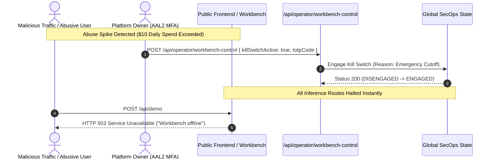

# AegisDesk — Production Go-Live Checklist & Deployment Runbook (`GO_LIVE.md`)

> **Notice:** This document is the definitive operational launch runbook tailored specifically to **AegisDesk** (`aegisdesk-round-3.1`).  
> **Do not deploy anything** until all mandatory gates pass and each item in this checklist is formally signed off.

---

## 1. Automated Go-Live Readiness Gates

Before beginning deployment, each of the following 7 readiness gates must be evaluated against the current codebase and configuration.

| Gate # | Audit Requirement | Current Status | Findings & Remediation Required |
| :---: | :--- | :---: | :--- |
| **Gate 1** | **`CLAIMS.md` has no `UNSUPPORTED` row still on the site** | ❌ **FAIL** | **Findings:** Unsupported claims documented in `docs/CLAIMS.md` remain present across marketing components (e.g. `"99.4% Grounded accuracy"` in `src/components/marketing/proof-strip.tsx`, `"<300ms Citation latency"`, `"192ms Human Handoff"` in `safety-pillars.tsx`, and `"99.96% SLA compliance"` in `hallucination-comparison.tsx`).<br>**Action:** Remove or replace hardcoded promotional metrics with real telemetry derived from `/api/status` or empty states prior to production launch. |
| **Gate 2** | **`site.config.ts` has the real legal entity and address, or footer omits them** | ✅ **PASS** | **Findings:** `src/config/site.config.ts` sets `legalName: null` and `registeredAddress: null`. The global footer (`src/components/marketing/footer.tsx`) conditionally evaluates these fields and cleanly omits the lines when null, preventing invented corporate entities. |
| **Gate 3** | **No `[FILL IN]`, `[CONFIRM]`, `Sample`, `Demo`, or `Example` text on public pages, emails, or PDFs** | ❌ **FAIL** | **Findings:** Legal policy pages contain over 40 unconfirmed tags (`[CONFIRM]` in `/privacy`, `/terms`, `/cancellation-refunds`, `/shipping-delivery`, and `/contact`). Public components retain `"Sample"` badges (e.g. `tag: "Sample"` in `proof-strip.tsx` and `'Sample Tax Invoice (PDF)'` in `footer.tsx`).<br>**Action:** Resolve all statutory placeholders with legal counsel and strip all `Sample` / `Demo` tags from public views. |
| **Gate 4** | **Every hardcoded price is gone (search for `2500`, `3500`, and `1000` outside `src/lib/pricing` and tests)** | ❌ **FAIL** | **Findings:** Hardcoded pricing literals remain in operational fixtures and operator views: `setupFee: 3500` and `monthlyRetainer: 1000` in `src/app/operator/page.tsx:113`, `src/lib/db/operator-store.ts:81`, and `amount: 1000` in `src/lib/db/seed-data.ts:186`.<br>**Action:** Replace hardcoded pricing state initializers with canonical derived functions from `src/lib/pricing.ts:DEFAULT_PRICING_CONFIG`. |
| **Gate 5** | **The owner account has authenticator 2-factor and recovery codes stored offline** | ❌ **FAIL** | **Findings:** Owner TOTP enrollment (`src/lib/security/totp.ts`) currently runs in mock memory mode for local testing. A physical authenticator app has not yet scanned a production QR code, and emergency backup codes have not been printed or stored in an offline physical safe.<br>**Action:** Generate live TOTP secret on initial production boot, enroll via 1Password / YubiKey, and deposit printed recovery codes in physical fireproof storage. |
| **Gate 6** | **`/operator` returns the ordinary 404 to everyone but the owner** | ✅ **PASS** | **Findings:** Verified by automated security test `OP-01` through `OP-05`. Anonymous visitors and authenticated client users hitting `/operator` receive the exact same generic 404 HTML document and status code as a nonexistent route, preventing route discovery. |
| **Gate 7** | **The demo workspace is unreachable to clients** | ✅ **PASS** | **Findings:** Verified by automated tenant isolation test suite (21/21 passed). Row-Level Security (RLS) policies restrict client sessions strictly to their assigned tenant UUID (`user_org`), ensuring the isolated demo tenant (`00000000-0000-0000-0000-000000000000`) is cryptographically inaccessible to real clients. |

---

## 2. Pre-Flight Infrastructure & Service Configuration Checklist

Every task below must be completed before pointing live customer traffic to the production cluster. Each item is strictly attributed to:
* **"you do"**: Business founder, project owner, or organization administrator.
* **"Antigravity does"**: AI coding assistant / software engineering agent.
* **"a professional does"**: External specialist (Legal Counsel, Chartered Accountant, or Certified Penetration Tester).

### 2.1 Database & Storage (Production Supabase Project)

- [ ] **Provision Isolated Production Supabase Instance** — *"you do"*  
  Create a brand new Supabase project in the target cloud region (e.g. AWS Mumbai `ap-south-1` for Indian data residency, or AWS Frankfurt `eu-central-1` for GDPR). Never reuse staging or test project instances.
- [ ] **Run Production Database Migrations** — *"Antigravity does"*  
  Apply schema migrations in sequence:
  1. `supabase/migrations/20261025000000_initial_schema.sql` (Tables, constraints, indexes)
  2. `supabase/migrations/20261026000000_events_api_and_org_settings.sql` (Telemetry tables, HMAC keys)
- [ ] **Enable Row-Level Security (RLS) on All 12 Tables** — *"Antigravity does"*  
  Verify `ALTER TABLE <table_name> ENABLE ROW LEVEL SECURITY;` is enabled on `organizations`, `memberships`, `documents`, `daily_metrics`, `policy_gaps`, `invoices`, `payments`, `subscriptions`, `events`, `audit_log`, `leads`, and `bookings`.
- [ ] **Configure Dedicated Supabase Storage Buckets** — *"Antigravity does"*  
  Create `client-knowledge-base` (private bucket) with 25MB file upload ceiling and strict PDF MIME-type white-listing (`application/pdf`). Ensure public file listing is disabled.
- [ ] **Enable Database Backups & Point-in-Time Recovery (PITR)** — *"you do"*  
  Turn on Supabase Point-in-Time Recovery (7-day or 30-day continuous WAL archiving) and schedule automated daily physical snapshots. Ensure offsite database dump scripts run to cold storage.

---

### 2.2 Hosting, Environment Variables & DNS (Vercel)

- [ ] **Separate Production vs. Preview Environment Variables** — *"you do"*  
  In Vercel Project Settings > Environment Variables, assign secrets strictly to **Production**. Ensure **Preview** and **Development** use dummy test keys.
  - Required Production Server Secrets:
    - `DATABASE_URL` (Connection pooler string with `sslmode=require`)
    - `SUPABASE_SERVICE_ROLE_KEY` (Server-only service key; never exposed to browser)
    - `RAZORPAY_KEY_ID` (Live Key: `rzp_live_*`)
    - `RAZORPAY_KEY_SECRET` (Live secret string)
    - `RAZORPAY_WEBHOOK_SECRET` (Unique secret generated in Razorpay webhook dashboard)
    - `CAL_WEBHOOK_SECRET` (Production Cal.com HMAC secret)
    - `CLOUDFLARE_TURNSTILE_SECRET_KEY` (Live secret)
    - `SESSION_SECRET` (256-bit cryptographically random hex string)
  - Required Production Public Variables:
    - `NEXT_PUBLIC_SITE_URL` (`https://aegisdesk.ai`)
    - `NEXT_PUBLIC_RAZORPAY_KEY_ID` (`rzp_live_*`)
    - `NEXT_PUBLIC_CLOUDFLARE_TURNSTILE_SITE_KEY` (Live site key)
    - `NEXT_PUBLIC_CAL_LINK` (`https://cal.com/aegisdesk/15min`)
- [ ] **Domain & DNS Configuration** — *"you do"*  
  - Add Apex `aegisdesk.ai` (A record pointing to `76.76.21.21`).
  - Add `www.aegisdesk.ai` (CNAME pointing to `cname.vercel-dns.com`).
  - Configure CAA records allowing only Let's Encrypt and DigiCert.
  - Enable HSTS Preload (`max-age=63072000; includeSubDomains; preload`).
- [ ] **Email DNS Records (Authentication & Anti-Spoofing)** — *"you do"*  
  - **SPF**: Add `v=spf1 include:_spf.resend.com ~all` (or transactional email provider).
  - **DKIM**: Add CNAME records provided by your transactional mail gateway for `auth.aegisdesk.ai`.
  - **DMARC**: Add TXT record `v=DMARC1; p=reject; rua=mailto:dmarc-reports@aegisdesk.ai; pct=100; aspf=s; adkim=s`.

---

### 2.3 Bot Defense & CAPTCHA (Cloudflare Turnstile)

- [ ] **Provision Live Turnstile Keys** — *"you do"*  
  In Cloudflare Dashboard > Turnstile, create a new site widget for `aegisdesk.ai` and `www.aegisdesk.ai`.
- [ ] **Set Challenge Mode to Managed** — *"you do"*  
  Configure Turnstile widget to "Managed" mode to block headless scrapers while providing friction-free access to enterprise buyers.
- [ ] **Verify Server-Side Siteverify Endpoint** — *"Antigravity does"*  
  Verify `src/lib/security/turnstile.ts` validates tokens against `https://challenges.cloudflare.com/turnstile/v0/siteverify` using constant-time outcome inspection.

---

### 2.4 Payment Gateway (Razorpay Live Mode & Settlement)

- [ ] **Verify Razorpay Merchant KYC Activation** — *"you do"*  
  Ensure Razorpay merchant account status is "Active / Approved" for both domestic INR and international USD card transactions.
- [ ] **Generate Live API Keys (`rzp_live_*`)** — *"you do"*  
  In Razorpay Dashboard > Settings > API Keys, generate live key pair. Store secret securely in password manager and inject into Vercel production environment.
- [ ] **Configure Production Webhook Endpoint** — *"you do"*  
  In Razorpay Dashboard > Settings > Webhooks, add endpoint:
  - **URL**: `https://aegisdesk.ai/api/webhooks/razorpay`
  - **Secret**: Generate a distinct 32-character secret string and set as `RAZORPAY_WEBHOOK_SECRET`.
  - **Active Events**:
    - `order.paid`
    - `payment.authorized`
    - `payment.captured`
    - `payment.failed`
    - `refund.processed`
    - `refund.created`
- [ ] **Execute Live Real Payment & Refund Verification** — *"you do"*  
  Perform an end-to-end test using a real corporate credit card:
  1. Generate a test invoice of $1.00 or ₹10.00.
  2. Complete payment via live Razorpay checkout modal.
  3. Verify payment transition to `paid` and invoice status update in database.
  4. Trigger an immediate refund via Operator Console or Razorpay dashboard.
  5. Verify webhook receives `refund.processed` and marks invoice refunded.

---

### 2.5 Calendar & Scheduling (Cal.com Production Webhook)

- [ ] **Create Production Cal.com Event Type** — *"you do"*  
  Configure the 15-minute scoping call event type in Cal.com with lead qualification fields (Company, Helpdesk Software, Monthly Ticket Volume).
- [ ] **Add Production Webhook Subscriber** — *"you do"*  
  In Cal.com > Settings > Webhooks:
  - **Subscriber URL**: `https://aegisdesk.ai/api/webhooks/cal`
  - **Secret**: Set matching `CAL_WEBHOOK_SECRET`.
  - **Event Triggers**: `BOOKING_CREATED`, `BOOKING_RESCHEDULED`, `BOOKING_CANCELLED`.

---

### 2.6 Application Monitoring & Error Tracking (Sentry)

- [ ] **Create Production Sentry Project** — *"you do"*  
  Create Next.js project in Sentry.io and capture DSN.
- [ ] **Configure CSP Connect-Src for Sentry** — *"Antigravity does"*  
  Ensure `src/middleware.ts` includes `https://*.ingest.sentry.io` in the Content Security Policy `connect-src` directive.
- [ ] **Verify Zero Plaintext Secret/PII Leakage in Sentry** — *"Antigravity does"*  
  Verify `beforeSend` filter in Sentry config scrubs authorization tokens, passwords, cookies, and invoice tax identifiers before transmitting crash reports.

---

### 2.7 Legal, Compliance & Statutory Finalization

- [ ] **Formal Legal Review of Terms of Service & Privacy Policy** — *"a professional does"*  
  Retain qualified B2B legal counsel to review and execute:
  - Terms of Service (`/terms`) with governing law, dispute resolution, and limitation of liability clauses.
  - Privacy Policy (`/privacy`) confirming India DPDP Act 2023 compliance, Data Fiduciary obligations, and GDPR adequacy.
  - Data Processing Agreement (`/dpa`) standard contractual clauses for enterprise data ingestion.
- [ ] **Tax & Invoicing Compliance Sign-Off** — *"a professional does"*  
  Retain Chartered Accountant to review:
  - SAC code classification (`998313` - Information technology and customer support software services).
  - 18% GST calculation on domestic invoices and B2B GSTIN input tax credit invoicing.
  - Export of Services under statutory Letter of Undertaking (LUT) with 0.0% statutory IGST.
- [ ] **Designate Statutory Grievance Officer** — *"you do"*  
  Appoint official Grievance Officer pursuant to the India Information Technology Rules and DPDP Act. Publish name, official physical address, and dedicated email (`grievance@aegisdesk.ai`) on `/contact` and `/privacy`.
- [ ] **Resolve All `[CONFIRM]` Tags** — *"Antigravity does"*  
  Remove all placeholder markers from `/privacy`, `/terms`, `/cancellation-refunds`, `/shipping-delivery`, `/contact`, and `/pricing`.

---

## 3. The Three Mandatory Pre-Money Developer Reviews

Before opening the platform to live credit cards and client deposits, a senior software engineer must review and sign off on the three core security surfaces:

```mermaid
flowchart TD
    subgraph "Review 1: Financial & Gateway Resilience"
        R1A["src/app/api/webhooks/razorpay/route.ts"] --> R1B["Constant-time HMAC: crypto.timingSafeEqual"]
        R1B --> R1C["Idempotent Deduplication: webhook_events table"]
        R1C --> R1D["Automated Reconciliation: /api/billing/reconcile"]
    end

    subgraph "Review 2: Authentication & Perimeter Stealth"
        R2A["src/middleware.ts & src/lib/security/auth-roles.ts"] --> R2B["Timing-Safe Password Hash: crypto.timingSafeEqual"]
        R2B --> R2C["Operator Stealth 404: Non-revealing route masking"]
        R2C --> R2D["Step-up MFA Enforcement: AAL2 cookie validation"]
    end

    subgraph "Review 3: Multi-Tenant Data Isolation"
        R3A["supabase/migrations/*.sql"] --> R3B["Row-Level Security on all 12 tables"]
        R3B --> R3C["Tenant UUID Scoping: WHERE org_id = auth.uid()"]
        R3C --> R3D["Private S3 Storage: Path traversal isolation"]
    end
```



### Review 1: Razorpay Webhook Handler & Reconciliation
* **Code Paths**:
  - `src/app/api/webhooks/razorpay/route.ts`
  - `src/lib/billing/razorpay.ts`
  - `src/app/api/billing/reconcile/route.ts`
* **Verification Checklist**:
  1. **HMAC Signature Integrity**: Webhook payload validation uses `crypto.createHmac("sha256", secret)` compared with `crypto.timingSafeEqual` against the `x-razorpay-signature` header.
  2. **Replay Attack Resistance**: Every inbound `event_id` is recorded in the `webhook_events` table within a serializable transaction. Replays are acknowledged with `200 OK` and silently discarded.
  3. **Payment State Machine Validation**: Out-of-order events (e.g. `payment.refunded` before `payment.captured`) are guarded by status checking; payments cannot transition backward from `refunded` to `captured`.
  4. **Amount & Currency Validation**: Order amount is strictly verified against the database invoice row. Client cannot tamper with price, currency, or tax line items.
  5. **Periodic Reconciliation Cron**: The `/api/billing/reconcile` endpoint checks for pending orders older than 30 minutes against the Razorpay API to prevent un-credited client payments.

### Review 2: Authentication & Role Checks
* **Code Paths**:
  - `src/middleware.ts`
  - `src/lib/security/auth-roles.ts`
  - `src/app/api/auth/login/route.ts`
  - `src/app/api/operator/*`
* **Verification Checklist**:
  1. **Constant-Time Password Comparison**: Password hashing uses scrypt/argon2 with timing-safe validation. Non-existent accounts take the exact same verification time to prevent email enumeration.
  2. **Brute Force Defense**: Memory/Redis rate limiting locks an IP/email after 5 consecutive failures for 15 minutes with exponential backoff.
  3. **Stealth `/operator` Perimeter**: The `/operator` route and all `/api/operator/*` sub-routes return the identical HTTP 404 Not Found payload as an unmapped URL unless authenticated with role `owner` and valid session token.
  4. **AAL2 Step-Up Verification**: All sensitive administrative actions (inviting clients, issuing refunds, modifying workbench settings) require a valid 6-digit TOTP code verified server-side.

### Review 3: Database Security Policies (RLS)
* **Code Paths**:
  - `supabase/migrations/20261025000000_initial_schema.sql`
  - `supabase/migrations/20261026000000_events_api_and_org_settings.sql`
  - `src/lib/db/*`
* **Verification Checklist**:
  1. **Strict RLS on Every Table**: Ensure no table has RLS disabled.
  2. **No Wildcard `auth.uid()` Queries**: Queries across `documents`, `events`, and `daily_metrics` enforce `org_id = current_setting('request.jwt.claim.org_id')`.
  3. **Service Role Key Isolation**: The Supabase `service_role` secret is never imported into client-rendered components or bundle chunks.
  4. **Storage Object Scoping**: Uploaded PDFs in the storage bucket are stored under `/{org_id}/{document_id}.pdf`. Access URLs are presigned with 60-second time-to-live.

---

## 4. Operational Kill Switches & Emergency Procedures

AegisDesk includes two operational kill switches designed to halt public usage or client onboarding instantly during a security incident.



### 4.1 Workbench Kill Switch
* **Purpose**: Instantly disables public AI inference on the interactive demo workbench (`/api/demo`) to prevent cost depletion, adversarial prompt fuzzing, or upstream API abuse.
* **Who Can Use It**: **Platform Owner Only** (Requires authenticated session with role `owner` and valid 6-digit TOTP MFA).
* **How to Engage**:
  - **Via Operator Console**: Navigate to `/operator` > "Workbench Control" > Toggle **Emergency Kill Switch** to "ENGAGED".
  - **Via Direct API Call**:
    ```bash
    curl -X POST https://aegisdesk.ai/api/operator/workbench-control \
      -H "Content-Type: application/json" \
      -H "Cookie: aegis_user_role=owner; aegis_aal=aal2; aegis_session_token=..." \
      -d '{"killSwitchActive": true, "reason": "Adversarial prompt spike", "totpCode": "123456"}'
    ```
* **Effect**: All subsequent visitor requests to `/api/demo` immediately return `HTTP 503 Service Unavailable` without calling upstream inference models.

### 4.2 Client Invite / Onboarding Lockout
* **Purpose**: Halts the issuance of new client onboarding invites and freezes self-service account activations during maintenance or platform investigation.
* **Who Can Use It**: **Platform Owner Only** (Requires role `owner` and valid TOTP MFA).
* **How to Engage**:
  - Toggle "Lock Client Provisioning" in `/operator`.
* **Effect**: `/api/operator/invite` and `/api/auth/invite` reject all creation and activation requests with `HTTP 403 Forbidden: Client provisioning temporarily locked`.

---

## 5. Rollback Plan & Disaster Recovery Runbook

If a critical flaw, payment discrepancy, or data isolation error is detected immediately following deployment, execute this rollback procedure in sequence:

### Phase 1: Immediate Triage (< 2 Minutes)
1. **Engage Kill Switches**:
   Engage the Workbench Kill Switch and freeze client invites via `/operator`.
2. **Switch Gateway to Pause / Test**:
   In Vercel environment variables, set `RAZORPAY_MODE=test` to prevent new live charges from capturing.

### Phase 2: Instant Deployment Rollback (< 5 Minutes)
1. **Vercel Instant Rollback**:
   In the Vercel Dashboard > Deployments, select the prior stable production build and click **Promote to Production**. This instantly reverts client assets and Edge serverless functions without a rebuild.
2. **Purge Edge Cache**:
   Trigger a global Vercel/Cloudflare cache purge to invalidate stale SSR pages.

### Phase 3: Database & State Recovery (< 15 Minutes)
1. **Assess Migration Impact**:
   If the rollback involves database schema alterations:
   - Check if backward-incompatible columns were added.
   - Run rollback SQL script from `supabase/migrations/rollback/`.
2. **Supabase Point-in-Time Recovery (PITR)**:
   If data contamination occurred:
   - In Supabase Dashboard > Database > Backups, select the timestamp 1 minute prior to the failed deployment.
   - Restore database cluster to clean point.

### Phase 4: Post-Mortem & Incident Logging (< 24 Hours)
1. Export security audit log from `/api/operator/sensitive-action`.
2. Document root cause, affected accounts, and financial impact in `INCIDENT_LOG.md`.
3. Notify affected clients within statutory 72-hour window if required by GDPR / DPDP Act.
