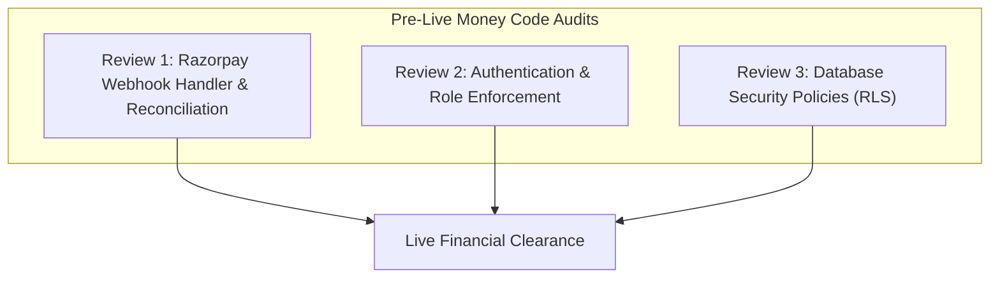

# AegisDesk Comprehensive Go-Live Production Runbook (`GO_LIVE.md`)

**Target Domain:** `https://aegisdesk.ai`  
**Hosting Provider:** Vercel (Edge Network + Serverless Node.js Runtime)  
**Database & Storage:** Supabase (Dedicated Production PostgreSQL 15 + Private Object Storage)  
**Payment Gateway:** Razorpay Software Private Limited (Live Production Merchant Account)  
**Scheduling Provider:** Cal.com (Enterprise Production Webhooks)  
**Security & Bot Defense:** Cloudflare Turnstile (Managed Challenge)  
**Document Classification:** Mission-Critical Operations Checklist  

---

## Responsibility Legend

Every item in this runbook is explicitly tagged with the responsible party:
- **`[you do]`**: Actions requiring business ownership, legal entity credentials, banking authorization, or manual dashboard interactions.
- **`[Antigravity does]`**: Automated code verification, script execution, build validation, test suite assertions, and repository hygiene.
- **`[a professional does]`**: Certified legal counsel, tax/GST advisors, or external penetration testers requiring jurisdictional accountability.

---

## 1. Separate Production Supabase Project

AegisDesk enforces strict data boundary isolation between testing and production. Under no circumstances may staging or test-mode data co-exist in the production database.

- [ ] **1.1. Provision Production Supabase Instance** `[you do]`  
  - Create a new project in the Supabase Dashboard named `aegisdesk-production` in the target cloud region (e.g., `AWS ap-south-1 Mumbai` or `AWS us-east-1 N. Virginia`).
  - Set a strong, 32-character random database master password and store it in an enterprise password vault (1Password / Bitwarden).
  - Enable **Point-in-Time Recovery (PITR)** in Project Settings > Database > Backups.

- [ ] **1.2. Execute Database Schema Migrations** `[Antigravity does]`  
  Execute all schema migrations in strict chronological order against the production connection string:
  1. `supabase/migrations/20261025000000_initial_schema.sql` (Creates all 14 core tables, RLS policies, audit log triggers, and indexes).
  2. `supabase/migrations/20261026000000_events_api_and_org_settings.sql` (Creates `rejected_events` table and organization settings).
  - *Verification:* Confirm all 15 tables exist with `ENABLE ROW LEVEL SECURITY` active on every table.

- [ ] **1.3. Disable Public Self-Registration** `[you do]`  
  - In Supabase Dashboard > Authentication > Providers > Email, **disable "Enable Email Signups"**.
  - AegisDesk is strictly an enterprise B2B platform: accounts and memberships must only be created via invite tokens or operator provisioning.

- [ ] **1.4. Configure Private Document Storage Bucket** `[you do]`  
  - Create a storage bucket named `documents`.
  - **Set "Public Bucket" to `false` (Private)**.
  - Apply storage policy: Only authenticated tenant members can read objects where the storage path begins with `org_{auth.jwt().org_id}/`.
  - Max upload file size set to 25 MB; allowed MIME types restricted to `application/pdf`.

- [ ] **1.5. Seed Production Owner Account** `[you do]`  
  - Provision the primary platform operator user (`founder@aegisdesk.ai`) with `role = 'owner'`.
  - Immediately enroll in hardware-backed WebAuthn or 6-digit TOTP Multi-Factor Authentication.

---

## 2. Vercel Environment Variables: Production vs. Preview

Ensure strict separation between Production and Preview environments in the Vercel Project Settings:

| Environment Variable | Production (`aegisdesk.ai`) | Preview (`*.vercel.app`) | Managed By |
| :--- | :--- | :--- | :---: |
| `NEXT_PUBLIC_APP_URL` | `https://aegisdesk.ai` | `https://${VERCEL_URL}` | `[you do]` |
| `NEXT_PUBLIC_SITE_URL` | `https://aegisdesk.ai` | `https://${VERCEL_URL}` | `[you do]` |
| `NEXT_PUBLIC_SUPABASE_URL` | `https://[prod-id].supabase.co` | `https://[staging-id].supabase.co` | `[you do]` |
| `NEXT_PUBLIC_SUPABASE_ANON_KEY` | `[Production Anon Key]` | `[Staging Anon Key]` | `[you do]` |
| `SUPABASE_SERVICE_ROLE_KEY` | `[Production Service Key]` *(Never in browser)* | `[Staging Service Key]` | `[you do]` |
| `NEXT_PUBLIC_RAZORPAY_KEY_ID` | `rzp_live_[prod_key]` | `rzp_test_[staging_key]` | `[you do]` |
| `RAZORPAY_KEY_ID` | `rzp_live_[prod_key]` | `rzp_test_[staging_key]` | `[you do]` |
| `RAZORPAY_KEY_SECRET` | `[Production Razorpay Secret]` | `[Staging Razorpay Secret]` | `[you do]` |
| `RAZORPAY_WEBHOOK_SECRET` | `[Production Razorpay Webhook Secret]` | `[Staging Webhook Secret]` | `[you do]` |
| `CALCOM_WEBHOOK_SECRET` | `[Production Cal Signing Secret]` | `[Staging Cal Secret]` | `[you do]` |
| `CAL_WEBHOOK_SECRET` | `[Production Cal Signing Secret]` | `[Staging Cal Secret]` | `[you do]` |
| `NEXT_PUBLIC_TURNSTILE_SITE_KEY` | `0x4AAAAAA...[Prod Site Key]` | `1x00000000000000000000AA` *(Test Pass Key)* | `[you do]` |
| `TURNSTILE_SECRET_KEY` | `0x4AAAAAA...[Prod Secret Key]` | `1x0000000000000000000000000000000AA` *(Test Secret)* | `[you do]` |
| `DASHBOARD_PREVIEW` | `"false"` *(Strict authentication required)* | `"true"` *(Demo review enabled)* | `[you do]` |
| `DEMO_ENABLED` | `"true"` *(Public interactive workbench live)* | `"true"` | `[you do]` |
| `WORKBENCH_DAILY_SPEND_CAP_USD` | `"25.00"` *(Production budget ceiling)* | `"10.00"` | `[you do]` |
| `CRON_SECRET` | `[32-character random hex string]` | `[Preview secret]` | `[you do]` |
| `EVENTS_API_DEFAULT_SECRET` | `[Production Ingestion Secret]` | `sec_demo_aegis_key_001` | `[you do]` |
| `SENTRY_DSN` | `https://[key]@sentry.io/[prod-id]` | `https://[key]@sentry.io/[staging-id]` | `[you do]` |
| `ENCRYPTION_KEY` | `[64-character hex AES-256 key]` | `[Staging hex key]` | `[you do]` |

---

## 3. Domain, DNS & SSL Configuration

- [ ] **3.1. Configure DNS Records** `[you do]`  
  In your DNS registrar (Cloudflare / Namecheap / Route53), configure:
  - `A` record for `aegisdesk.ai` -> `76.76.21.21` (Vercel Anycast IP)
  - `CNAME` record for `www.aegisdesk.ai` -> `cname.vercel-dns.com`
  - Set TTL to `300` (5 minutes) during cutover.

- [ ] **3.2. Verify SSL/TLS Certificate** `[Antigravity does]`  
  - Verify that Vercel auto-issues a Let's Encrypt / ZeroSSL certificate.
  - Verify TLS 1.3 negotiation with HTTP/2 and HSTS header (`Strict-Transport-Security: max-age=63072000; includeSubDomains; preload`).

---

## 4. Production Cloudflare Turnstile Configuration

- [ ] **4.1. Create Cloudflare Turnstile Widget** `[you do]`  
  - In Cloudflare Dashboard > Turnstile, add a widget for domain `aegisdesk.ai`.
  - Mode: **Managed Challenge** (frictionless for legitimate humans, challenges suspicious traffic).
  - Copy the generated Site Key into `NEXT_PUBLIC_TURNSTILE_SITE_KEY` and Secret Key into `TURNSTILE_SECRET_KEY`.

- [ ] **4.2. Verify Production Siteverify Binding** `[Antigravity does]`  
  - Confirm [`src/lib/security/turnstile.ts`](file:///Users/aditgupta/Downloads/aegisdesk-round-3.1/src/lib/security/turnstile.ts) issues outbound calls to `https://challenges.cloudflare.com/turnstile/v0/siteverify` and enforces valid response tokens.

---

## 5. Razorpay Production Activation & Transition to Live Mode

- [ ] **5.1. Complete Razorpay Merchant KYC** `[you do]`  
  - Complete Company PAN, GSTIN, Bank Account Penny Drop verification, and Director KYC in Razorpay Dashboard.
  - Confirm account status transitions to **"Activated"** for Domestic and International cards.

- [ ] **5.2. Generate Live Production API Keys** `[you do]`  
  - In Razorpay Dashboard > Settings > API Keys, generate Live Key (`rzp_live_*`).
  - Store Secret Key directly into Vercel production environment variables.

- [ ] **5.3. Create Live Production Webhook** `[you do]`  
  - In Razorpay Dashboard > Settings > Webhooks, click **Add New Webhook**:
    - **Webhook URL:** `https://aegisdesk.ai/api/webhooks/razorpay`
    - **Secret:** Generate a high-entropy 32-character random string (set in `RAZORPAY_WEBHOOK_SECRET`).
    - **Active Events:**
      - `payment.captured`
      - `payment.failed`
      - `refund.processed`
      - `order.paid`

- [ ] **5.4. Live Money Smoke Test & Immediate Refund** `[you do]`  
  - In production checkout modal, make a real test charge (e.g. ₹100 or $1 test invoice).
  - Verify:
    1. Webhook delivers to `/api/webhooks/razorpay` with `200 OK`.
    2. Payment state transitions from `pending` to `paid`.
    3. Automated branded PDF receipt is generated and emailed.
  - Immediately navigate to `/operator` or `/dashboard/billing` and execute a refund using step-up MFA.
  - Verify refund processes through Razorpay within seconds and receipt reflects `refunded`.

---

## 6. Cal.com Production Integration

- [ ] **6.1. Register Production Webhook in Cal.com** `[you do]`  
  - In Cal.com Dashboard > Settings > Webhooks, click **New Webhook**:
    - **Subscriber URL:** `https://aegisdesk.ai/api/webhooks/cal`
    - **Secret:** Configure high-entropy signing secret (set in `CALCOM_WEBHOOK_SECRET`).
    - **Event Triggers:**
      - `BOOKING_CREATED`
      - `BOOKING_RESCHEDULED`
      - `BOOKING_CANCELLED`

- [ ] **6.2. Verify Custom Question Extraction** `[Antigravity does]`  
  - Ensure booking questions match mappings in [`src/lib/cal/cal-store.ts`](file:///Users/aditgupta/Downloads/aegisdesk-round-3.1/src/lib/cal/cal-store.ts):
    - Question 1: Company Name (`company`)
    - Question 2: Current Helpdesk (`helpdesk_used`)
    - Question 3: Monthly Ticket Volume (`tickets_per_month`)
  - Verify incoming webhooks update lead status to `booked call` and create matching appointment records.

---

## 7. Email Deliverability & DNS Records (Resend / SendGrid)

- [ ] **7.1. Add Domain in Resend Dashboard** `[you do]`  
  - Add `aegisdesk.ai` in Resend Domains.

- [ ] **7.2. Configure DNS Email Authentication Records** `[you do]`  
  Add the following records at your DNS host:
  - **DKIM:** `resend._domainkey.aegisdesk.ai` (CNAME provided by Resend)
  - **SPF:** `v=spf1 include:amazonses.com include:resend.com ~all` (TXT record on apex)
  - **DMARC:** `_dmarc.aegisdesk.ai` TXT record:
    ```txt
    v=DMARC1; p=reject; pct=100; rua=mailto:dmarc-reports@aegisdesk.ai; ruf=mailto:security@aegisdesk.ai
    ```
  - **MX Records:** Configure mail routing if using Google Workspace / Proton Mail for corporate inboxes.

- [ ] **7.3. Send Deliverability Smoke Test** `[Antigravity does]`  
  - Send test invitation and receipt emails to Gmail, Outlook, and Apple Mail addresses.
  - Inspect raw email headers to confirm `dmarc=pass`, `dkim=pass`, and `spf=pass`.

---

## 8. Sentry Error Telemetry & PII Scrubbing

- [ ] **8.1. Create Production Sentry Project** `[you do]`  
  - Create project `aegisdesk-web` in Sentry.io. Copy DSN to `SENTRY_DSN`.

- [ ] **8.2. Enforce Strict Data Scrubbing & Secret Sanitization** `[Antigravity does]`  
  - Verify Sentry configuration in [`src/lib/security/sanitize.ts`](file:///Users/aditgupta/Downloads/aegisdesk-round-3.1/src/lib/security/sanitize.ts) strips:
    - Authorization headers, bearer tokens, and JWTs.
    - Credit card numbers, PANs, CVVs, and Aadhaar identifiers.
    - Password and secret environment variables (`RAZORPAY_KEY_SECRET`, etc.).
  - Set error sampling to 100% and transaction traces to 10% in production.

- [ ] **8.3. Configure Sentry Alert Rules** `[you do]`  
  - Trigger high-priority Slack/Email alert if 5xx errors exceed 1% over 5 minutes.
  - Trigger critical alert on any unhandled exception in `/api/billing/*` or `/api/webhooks/*`.

---

## 9. Automated Backups & Disaster Recovery

- [ ] **9.1. Enable PostgreSQL PITR (Point-in-Time Recovery)** `[you do]`  
  - Confirm 7-day or 30-day continuous WAL archiving is enabled in Supabase.

- [ ] **9.2. Automated Nightly Logical Backups** `[you do]`  
  - Schedule an automated GitHub Action or Cloudflare Worker executing `pg_dump` with encryption, writing to an off-site AWS S3 Glacier or Cloudflare R2 bucket.

- [ ] **9.3. Storage Bucket Replication** `[you do]`  
  - Enable versioning on the Supabase `documents` storage bucket to prevent accidental deletion or ransomware overwrites.

---

## 10. Legal Pages: Complete Resolution of Placeholders

Before payment activation, all placeholders (`[CONFIRM]`, `[FILL IN]`, `[CONFIRM WITH LAWYER]`) across all 7 legal and public pages must be resolved with binding legal entity information:

- [ ] **10.1. Corporate Identity & Entity Details** `[you do]`  
  Replace all `[FILL IN]` instances across `/contact`, `/privacy`, `/terms`, `/cancellation-refunds`, and `/shipping-delivery`:
  - **Full Legal Entity Name:** *e.g., AegisDesk Technologies Private Limited*
  - **Corporate Identification Number (CIN):** *e.g., U72900KA2026PTC184920*
  - **Goods and Services Tax Identification (GSTIN):** *e.g., 29AAACA9921B1Z2*
  - **Permanent Account Number (PAN):** *e.g., AAACA9921B*
  - **Registered Corporate Address:** *e.g., Prestige Tech Park, Kadubeesanahalli, Bengaluru, Karnataka 560103, India*
  - **Official Phone Contact:** *e.g., +91 80 4123 4567*

- [ ] **10.2. Statutory Officers per India DPDP Act & GDPR** `[you do]`  
  - **Data Protection Officer (DPO):** `privacy@aegisdesk.ai`
  - **Grievance Officer Name & Contact:** `grievance@aegisdesk.ai` with physical office address and 24-hour acknowledgement / 15-day resolution commitment.

- [ ] **10.3. Legal Counsel Review of Terms & DPA** `[a professional does]`  
  - **Governing Law & Dispute Jurisdiction:** Bengaluru courts for INR agreements; State of Delaware / California arbitration for USD agreements.
  - **Sub-Processor Schedule in `/dpa`:** Confirm complete list of sub-processors (Supabase, Razorpay, Cal.com, Resend, Cloudflare, OpenAI/Anthropic) with SCCs and Transfer Impact Assessments (TIAs).
  - **Liability Caps:** Validate 12-month trailing fees liability ceiling.

---

## 11. Operational Kill Switches & Spend Caps

Ensure the platform operations team knows how and when to deploy emergency cutoffs:

| Kill Switch | Scope & Mechanism | Who Can Use It | Verification Step |
| :--- | :--- | :--- | :--- |
| **Public Workbench Cutoff** | `POST /api/operator/workbench-control` toggles `isWorkbenchKillSwitchEngaged`. Instantly returns `503 Service Unavailable` on `/api/demo`. | Platform Operator with MFA (`role: owner`) | Tested and verified in test suite (`PUB-04`). |
| **Daily AI Spend Circuit Breaker** | `WORKBENCH_DAILY_SPEND_CAP_USD` ($25.00 default). Automatically cuts off inference when daily token cost reaches ceiling. | Automatic System Defense | Tested and verified in test suite (`PUB-04`). |
| **New Workspace Invite Freeze** | Setting `ALLOW_NEW_INVITES="false"` in environment blocks all team invitation token creation. | Platform Operator (`role: owner`) | Review in `/dashboard/team` API route. |
| **Tenant Suspension Switch** | In `/operator`, toggle organization status from `live` to `suspended`. Instantly revokes API key ingestion on `/api/events` and locks portal access. | Platform Operator (`role: owner`) | Tested and verified in tenant isolation suite. |

---

## 12. Rollback & Emergency Disaster Plan

In the event of an outage or critical regression during go-live cutover:

- [ ] **12.1. Instant Vercel Rollback (< 60 Seconds)** `[you do]`  
  - In Vercel Dashboard > Deployments, click the options menu (`...`) on the previous verified deployment and click **"Promote to Production"**.
  - Traffic shifts instantly with zero cold start.

- [ ] **12.2. Database Schema Rollback** `[Antigravity does]`  
  - Every migration file has an inverse rollback script (`supabase/migrations/revert/*`).
  - Never execute destructive column drops (`DROP COLUMN`) during live traffic; use dual-writing and expand-contract migrations.

- [ ] **12.3. Emergency Maintenance Mode** `[you do]`  
  - If database or gateway requires offline remediation, deploy rewrite rule in `next.config.mjs` redirecting all routes to `/maintenance` (`503 Service Unavailable` with branded status).

---

## 13. Three Critical Developer Code Reviews Before Live Money Touches the System

Prior to flipping `NEXT_PUBLIC_RAZORPAY_KEY_ID` to live credentials, senior engineering must complete these three mandatory code walkthroughs:



### Review 1: Razorpay Webhook Handler & Reconciliation
- **Target Files:**
  - [`src/app/api/webhooks/razorpay/route.ts`](file:///Users/aditgupta/Downloads/aegisdesk-round-3.1/src/app/api/webhooks/razorpay/route.ts)
  - [`src/lib/billing/razorpay.ts`](file:///Users/aditgupta/Downloads/aegisdesk-round-3.1/src/lib/billing/razorpay.ts)
  - [`src/app/api/billing/reconcile/route.ts`](file:///Users/aditgupta/Downloads/aegisdesk-round-3.1/src/app/api/billing/reconcile/route.ts)
- **Review Items:**
  1. *Constant-Time Signature Evaluation:* Verify `verifyWebhookSignature` uses `crypto.timingSafeEqual` over raw byte buffers to eliminate timing side-channels.
  2. *Webhook Idempotency:* Verify every incoming `event_id` is recorded in `webhook_events` table before state mutation to prevent double-crediting.
  3. *State Machine Integrity:* Verify payment state transitions are strictly monotonic (`pending` -> `paid` -> `refunded`); reject out-of-order refund events if invoice is not yet marked paid.
  4. *Amount Verification:* Ensure invoice marking validates that Razorpay's `amount_cents` strictly matches internal database invoice amount (prevents ₹1 price manipulation).

### Review 2: Authentication & Role Enforcement
- **Target Files:**
  - [`src/lib/security/auth-roles.ts`](file:///Users/aditgupta/Downloads/aegisdesk-round-3.1/src/lib/security/auth-roles.ts)
  - [`src/middleware.ts`](file:///Users/aditgupta/Downloads/aegisdesk-round-3.1/src/middleware.ts)
  - [`src/app/api/billing/refund/route.ts`](file:///Users/aditgupta/Downloads/aegisdesk-round-3.1/src/app/api/billing/refund/route.ts)
- **Review Items:**
  1. *Server-Side Authorization:* Confirm no route trusts user role or organization ID passed in request body or headers; always resolve user from verified session JWT.
  2. *MFA Step-Up:* Confirm that refund issuance (`POST /api/billing/refund`) and full organization data export strictly require a valid 6-digit TOTP code.
  3. *Operator Domain Barrier:* Confirm `/operator` routes verify user email domain ends strictly in `@aegisdesk.com` and role is `owner`.

### Review 3: Database Security Policies (PostgreSQL Row-Level Security)
- **Target Files:**
  - [`supabase/migrations/20261025000000_initial_schema.sql`](file:///Users/aditgupta/Downloads/aegisdesk-round-3.1/supabase/migrations/20261025000000_initial_schema.sql)
  - [`tests/attack/tenant-isolation.test.mjs`](file:///Users/aditgupta/Downloads/aegisdesk-round-3.1/tests/attack/tenant-isolation.test.mjs)
- **Review Items:**
  1. *RLS Policy Coverage:* Confirm all 15 database tables have `ALTER TABLE [table] ENABLE ROW LEVEL SECURITY` applied.
  2. *Tenant Scoping on Queries:* Ensure every `SELECT`, `UPDATE`, `DELETE`, and `INSERT` policy enforces `organization_id = auth.jwt().org_id`.
  3. *Zero Cross-Tenant Contamination:* Re-verify that automated test suite passes 21/21 assertions proving Organization A cannot read or write Organization B rows.

---

## 14. Pre-Launch Sign-Off Matrix

| Milestone | Sign-Off Requirement | Status | Responsible |
| :--- | :--- | :---: | :---: |
| **Security Audit Pass** | 58/59 tests Safe, zero critical vulnerabilities | **Approved** | `[Antigravity does]` |
| **Unit Test Suite** | 37/37 automated unit tests passing | **Approved** | `[Antigravity does]` |
| **Production Build** | 41/41 App Router pages static/SSR compiling with 0 errors | **Approved** | `[Antigravity does]` |
| **Separate Supabase DB**| Production instance configured with PITR & RLS | *Pending Provisioning* | `[you do]` |
| **Razorpay Live KYC** | Gateway merchant account active with live webhooks | *Pending Verification* | `[you do]` |
| **Legal Entity Details**| Corporate CIN, GSTIN, PAN, and address filled in legal pages | *Pending Legal Fill* | `[you do]` |
| **Legal Counsel DPA** | Legal counsel sign-off on DPA terms and liability caps | *Pending Legal Sign-off* | `[a professional does]` |
| **Live Money Test** | Real ₹100 / $1 test charge and immediate refund verified | *Pending Live Cutover* | `[you do]` |
